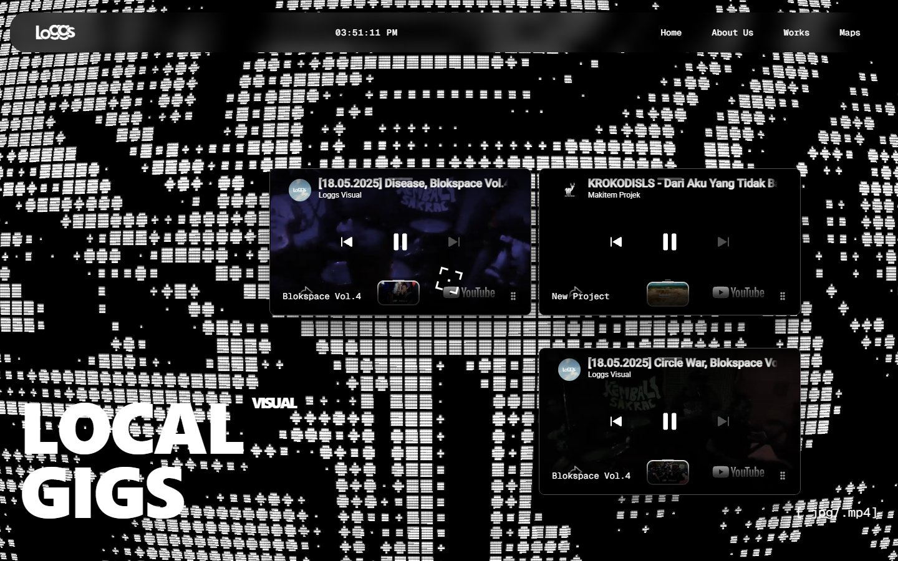
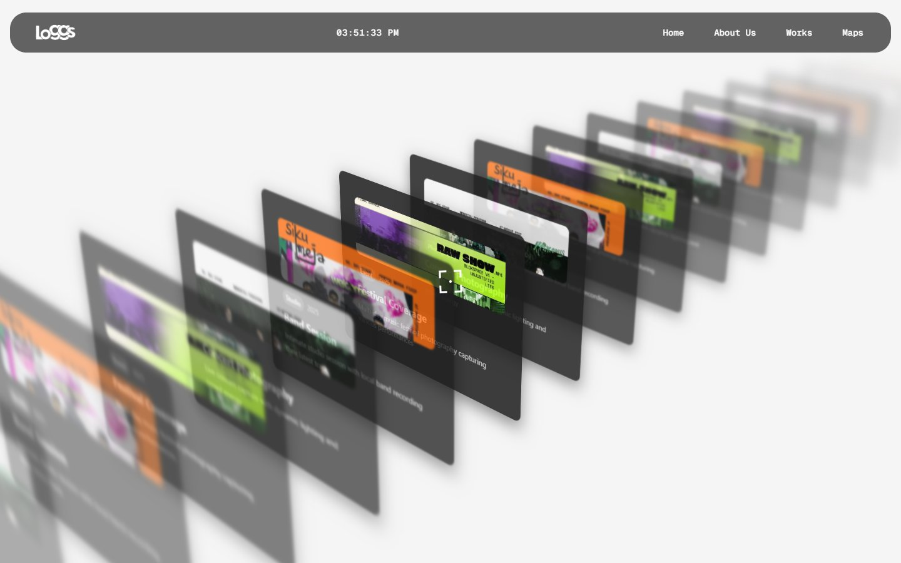

<p align="center">
  <picture>
    
  </picture>
</p>

<h1 align="center">Loggs Visual</h1>

Loggs Visual documents the local music scene in Pangkal Pinang. This repository is the project's portfolio site: a motion-heavy home for live-show photography, band sessions, and video coverage. It runs on Next.js with no CMS or database. Gallery, works, and video content live in TypeScript config files.

<p align="center">
  <a href="https://loggsvisual.com">
    
  </a>
  
  
  
  
  
  
  <a href="https://github.com/Giandri/Loggs-Visual">
    
  </a>
</p>



## Key Capabilities

- **Terminal hero** - A WebGL dithered terminal background, draggable YouTube cards, and oversized typography.
- **Horizontal highlights** - A scroll-driven photo strip of live shows from the local scene.
- **3D works archive** - Projects are arranged as a layered deck with depth of field, autoplay, hover elevation, and detail modals.
- **About timeline** - A keyhole zoom transition leads into an animated timeline of the project.
- **Motion system** - Lenis smooth scrolling, a custom cursor, and GSAP/Motion transitions throughout the site.
- **Config-driven content** - Gallery items, works, and video cards are plain TypeScript data.
- **Image pipeline** - A Sharp script turns gallery uploads into optimized WebP files.

For the full experience, open the [live demo](https://loggsvisual.com).

## Screenshots

<p align="center">
  
</p>

## Tech Stack

<p align="center">
  <a href="https://skillicons.dev">
    
  </a>
</p>

Animation uses Motion (Framer Motion), GSAP, and Lenis. The terminal background is rendered with OGL. Gallery images are compressed with Sharp.

## Resources

- [Live Demo](https://loggsvisual.com)
- [GitHub Repository](https://github.com/Giandri/Loggs-Visual)
- [Issue Tracker](https://github.com/Giandri/Loggs-Visual/issues)
- [Loggs Maps](https://maps.loggsvisual.com) - the coffee shop map for Pangkal Pinang

## Getting Started

Requires Node.js 20.9 or newer.

```bash
git clone https://github.com/Giandri/Loggs-Visual.git
cd Loggs-Visual
npm install
npm run dev
```

Open [http://localhost:3000](http://localhost:3000) in your browser.

To verify a production build:

```bash
npm run build
npm run start
```

## Project Structure

```text
src/app/            App Router pages: /, /about, /works
src/components/     WebGL, motion, gallery, and UI components
src/config/         Gallery, works, and YouTube card data
src/lib/            Metadata and shared utilities
public/gallery/     Source photos and optimized WebP output
scripts/            Sharp image optimization script
docs/screenshots/   README screenshots
```

## Content Workflow

The site has no admin panel. Content changes are code changes:

1. Add photos to `public/gallery/`.
2. Run `node scripts/optimize-images.js` to generate WebP files in `public/gallery/optimized/`.
3. Add or update entries in `src/config/gallery.ts` and `src/config/works.ts`.
4. Add video cards in `src/config/youtube-cards.ts`.
5. Commit the changes and deploy.

## Deployment

The live site runs at [loggsvisual.com](https://loggsvisual.com) on Vercel.

No environment variables, database, or server-side secrets are required. Run `npm run build` before pushing to catch production build errors.

## Notes

- Content is hard-coded in config files. Every update needs a new deploy.
- The Maps link opens a separate project, [Loggs Maps](https://maps.loggsvisual.com).
- The WebGL background lowers its pixel ratio and disables mouse interaction on small screens.
- The Privacy Policy and Terms of Service links in the footer are placeholders.
- The homepage stats are display values in `src/app/page.tsx`, not live counters.

## Support

Open an issue at [github.com/Giandri/Loggs-Visual/issues](https://github.com/Giandri/Loggs-Visual/issues).

## Contributing

Issues and pull requests are welcome. Describe the change and include screenshots for UI updates.

## Credits

Built by [Giandri](https://github.com/Giandri) for Loggs Visual.

Photography and video by Loggs Visual. Fonts by Vercel (Geist). Icons by Lucide and React Icons. WebGL background powered by OGL.
